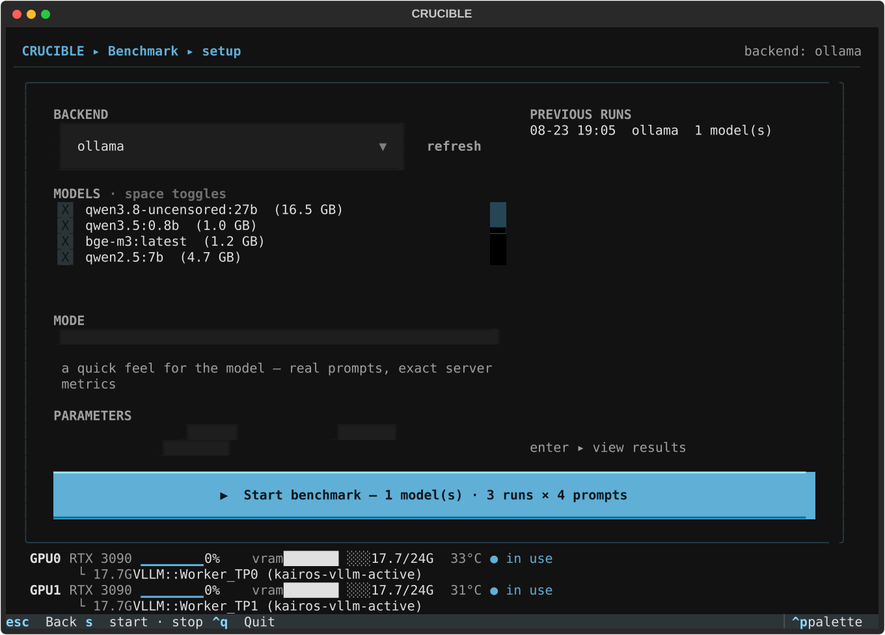
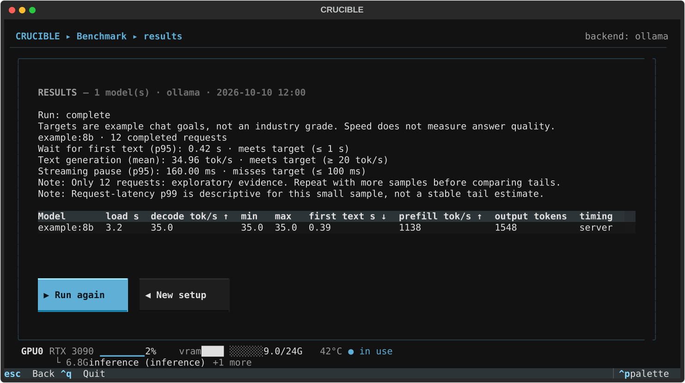
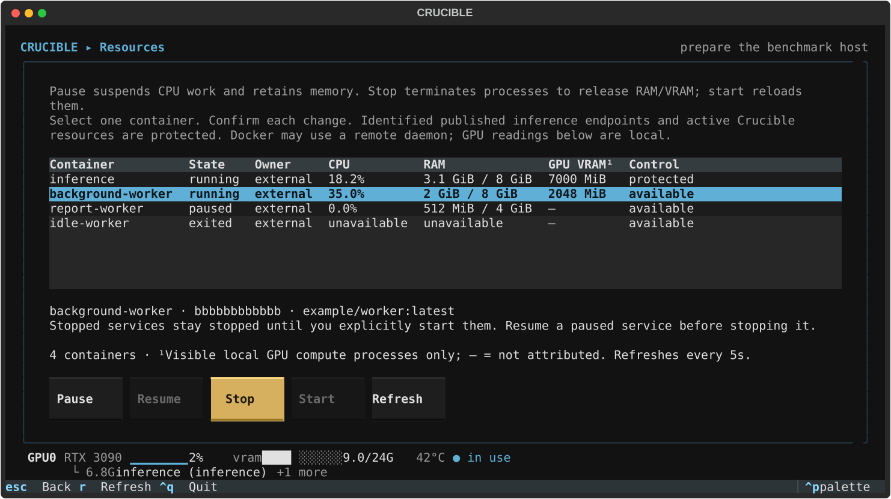

# CRUCIBLE

**Benchmark local LLMs, understand the results, and prepare the test environment.**

[](https://github.com/AthlasSoftware/crucible/actions/workflows/ci.yml)
[](pyproject.toml)
[](LICENSE)

Crucible is a terminal workbench for **Ollama, vLLM and OpenAI-compatible
servers**. Measure model performance, check repeatability and tool calling,
inspect configuration, or give a model a sandboxed terminal and browser.

Results explain what the numbers mean, whether they meet your targets, and
where the evidence is limited. JSON and Markdown reports keep the measurements
and the context needed to review them.

[Quickstart](#quickstart) · [Reading results](#reading-results) ·
[Benchmark modes](#benchmark-modes) · [Resources](#prepare-the-test-environment) ·
[Configuration](#configuration) · [Methodology](#measurement-and-limitations)


*Screenshots use illustrative fixture data; they are not published benchmark results.*

## Quickstart

You need [uv](https://docs.astral.sh/uv/), Python 3.12+ and a running model
server. Docker is optional for benchmarking; it is required for sandboxed
sessions, terminal/browser resources, container controls and managed vLLM.

```sh
git clone https://github.com/AthlasSoftware/crucible.git
cd crucible
uv run crucible
```

The first launch creates `~/.config/crucible/config.toml`. The default backend
is Ollama at `http://127.0.0.1:11434`; vLLM defaults to
`http://127.0.0.1:8000`. Use **Config** (`c`) to change endpoints and models.

For a first run:

1. Open **Benchmark** (`b`), select your backend and choose a model.
2. Check the machine monitor. Open **Resources** (`e`) to inspect competing containers.
3. Choose **quick**, review the targets and start the benchmark.
4. Read the interpretation, then open **Reports** (`r`) to revisit the saved report.

`uv run crucible --inline` opens the inline CLI. Non-TTY invocations also use
it. The full mode selector, Inspect and Resources are available in the TUI;
the inline CLI currently covers quick benchmarks, sessions, harness, reports
and configuration.

## Reading results

A throughput number alone does not tell you how a model will feel to use.
Quick results explain three parts of the experience:

| Metric | What it tells you | Better direction | Default example target |
|---|---|---|---|
| **First-text wait · p95** | How long you wait before visible output begins | Lower | ≤ 1 second |
| **Text generation · mean** | How quickly the model decodes output for one request | Higher | ≥ 20 tokens/second |
| **Streaming pause · p95** | Gaps between received content chunks; reveals stutter | Lower | ≤ 100 milliseconds |

**Mean** is the average. **p95** describes the slower end of the observed sample:
roughly 95% of measured values fall at or below it. It helps reveal waits or
pauses that an average can hide.

Targets are editable in benchmark setup and saved with the run. They are
**example chat goals**, not universal hardware grades. Different applications
need different targets, and speed does not measure answer quality.

For example, an illustrative result might read:

| Experience | Measured | Target | Result |
|---|---|---|---|
| First-text wait · p95 | 0.42 s | ≤ 1 s | Meets target |
| Text generation · mean | 35 tok/s | ≥ 20 tok/s | Meets target |
| Streaming pause · p95 | 160 ms | ≤ 100 ms | Misses target |

Here, output starts quickly and average decode speed meets the goal, but
streaming has noticeable gaps relative to the chosen target. Missing usage
counts or observed hidden reasoning can make visible-text decode speed
**not measured** rather than produce a misleading grade.

Reports include sample counts, uncertainty summaries, actual token ranges,
completion status and follow-up notes. Small samples remain exploratory even
when every target is met. Cancelled or failed runs retain completed samples
and are marked incomplete.

<details>
<summary>Preview benchmark setup and results</summary>





</details>

## Benchmark modes

| Mode | Use it to answer | What runs |
|---|---|---|
| **Quick** | How does this model feel to use? | Four bundled prompts × your chosen repetitions; first-text wait, decode speed and streaming pauses |
| **Standard** | What are the prefill and decode rates? | Deterministic synthetic prompts, configurable repetitions/output cap, optional warmups and mean ± standard deviation |
| **Context sweep** | What changes with longer context? | Prefill/decode at approximate 0/4k/8k/16k context targets, with explicit cache-reuse evidence where exposed |
| **Determinism** | Do repeated requests produce identical output? | Same prompt, pinned seed and temperature 0; distinct outputs and first divergence |
| **Tool calling** | Can the model select tools and fill arguments? | Twelve bundled cases × configurable trials: selection, typed arguments, parallel calls and abstention; no tools are executed |

**Standard and context labels are targets, not tokenizer-exact lengths.**
`pp512` uses a 512-word synthetic prompt; the report records actual token
counts. These are API measurements and should not be treated as interchangeable
with llama-bench results.

Identical determinism outputs establish observed repeatability, not proof
that a backend honors the seed. Tool-calling results include Wilson intervals
and flaky cases, but repeated cases are correlated. The bundled suite is not
an official BFCL score.

Before a run, **MODEL FACTS** shows available context metadata, configured
Ollama `num_ctx`, estimated KV-cache cost and estimated context capacity in
free VRAM. Metadata and estimates depend on what the backend exposes.

## Prepare the test environment

Open **Resources** (`e`) from Home or Benchmark setup to inspect running and
stopped Docker containers. The screen shows ownership, CPU/RAM and attributed
local GPU compute memory.

| Action | Effect | Memory and recovery |
|---|---|---|
| **Pause** | Suspends the container's processes | Allocated memory remains; not a GPU-memory release operation |
| **Resume** | Continues paused processes | The workload can compete for resources again |
| **Stop** | Terminates the service, with a 10-second graceful shutdown before force | In-memory work is lost; check GPU readings for released allocations |
| **Start** | Starts a stopped service | Processes/models reload and can allocate memory again |

Each action targets one selected container, asks for confirmation with
**Cancel** selected, and revalidates its identity and state. Active resources
owned by this Crucible process and containers publishing configured local
inference ports are protected. Stop is disabled for `--rm` containers because
Docker would delete them. Resume a paused container before stopping it.

Services are restored explicitly with Start or Resume. Closing the screen
does not restore them automatically. Docker can target a remote daemon while
GPU readings remain local; missing GPU attribution (`—`) does not prove zero
GPU use. Port-based protection cannot identify every proxy or host-network endpoint.



## Inspect and interact

| Workspace | What it does |
|---|---|
| **Inspect · `x`** | Flags missing `num_ctx`, template/tool/system issues, double BOS and stop-sequence problems; probes native tool-call support and saves a report |
| **Session · `s`** | Gives a model a disposable Docker shell with resource limits, command approval and a live transcript; network is off by default |
| **Harness · `h`** | Starts a chat and lets you attach terminals, a persistent headless browser or SearXNG search during the conversation |
| **Reports · `r`** | Browses saved reports and transcripts; read, open in `$EDITOR` or delete them |
| **Config · `c`** | Edits backend URLs, model defaults, sandbox limits and harness settings in one TOML file |

Sessions use a `run_shell` tool, with a fenced-block fallback when native tools
are unsupported. Harness tools are namespaced by resource (`terminal_run`,
`browser_goto`, `search_web`). Default approval prompts stop actions for review;
auto approval is an explicit option.

The Home screen also offers **Release resources** when Crucible-labelled
containers exist. That separate cleanup action removes labelled sessions,
harness resources and managed servers after confirmation; transcripts are kept.

## Configuration

Settings live at `~/.config/crucible/config.toml`; reports and transcripts
live under `~/.local/share/crucible/`. Crucible respects `XDG_CONFIG_HOME` and
`XDG_DATA_HOME`.

A minimal Ollama configuration:

```toml
[backend]
active = "ollama"                  # ollama | vllm | openai

[backend.ollama]
base_url = "http://127.0.0.1:11434"
default_model = "llama3.1:8b"

[benchmark]
runs = 3
max_tokens = 256
warmup = true
```

<details>
<summary>Other endpoints, sandbox resources and managed vLLM</summary>

```toml
[backend.vllm]
base_url = "http://127.0.0.1:8000"

[backend.openai]
base_url = ""                      # any OpenAI-compatible endpoint
api_key = ""

[sandbox]
image = "ubuntu:24.04"
cpus = 4.0
memory = "4g"
network = false                   # enable for package downloads
approval = "approve-each"         # approve-each | auto
command_timeout_s = 60
max_iterations = 20

[harness]
terminal_image = "ubuntu:24.04"
browser_image = "mcr.microsoft.com/playwright/python:v1.55.0-noble"
cpus = 4.0
memory = "4g"
terminal_network = false          # browser resources use network
approval = "approve-each"
command_timeout_s = 60
max_tool_calls = 12
searxng_url = ""                  # empty = autodetect a searxng container

[vllm_server]
enabled = false                  # opt in to a server Crucible manages
image = "vllm/vllm-openai:latest"
port = 8100
hf_cache = "crucible-hf-cache"
tensor_parallel_size = 1
gpu_memory_utilization = 0.90
max_model_len = 8192

[ui]
render_markdown = true            # false shows model replies as raw text
```

Managed vLLM runs on its own port and refuses to start when detected GPU
holders would prevent loading. Its weight cache is configurable. The search
resource needs a SearXNG instance with JSON output enabled
(`search.formats: [html, json]`).

</details>

## Measurement and limitations

- **Timing sources are explicit.** Ollama throughput uses server durations;
  prefill subtracts reported cached tokens. OpenAI-compatible throughput uses
  client timing and is marked **≈**, even when token counts are server-reported.
- **Latency is measured at the client.** Time to first text (TTFT) begins at the
  request and ends at the first visible content chunk. End-to-end latency (E2EL)
  ends at the last content chunk, excluding delayed usage/done messages.
  Chunk gaps are not necessarily token gaps.
- **Warmup is excluded when enabled.** Standard mode warms prefill and decode;
  disabling warmup leaves cold-start effects visible in the measurements.
- **Uncertainty stays visible.** Throughput has standard deviation; latency has
  percentiles and sample counts. Tool pass rates have descriptive Wilson intervals.
  Small samples do not establish stable production p95/p99 performance.
- **Cache and completion are checked.** Context cache reuse is unverified when
  explicit cached-token counts are absent. Interrupted streams and skipped depths
  are reported rather than presented as a completed suite.
- **Provenance has a scope.** Reports record client/server versions, workload
  hashes and available model metadata. Hardware/container snapshots describe the
  client host before and after a performance run; they do not prove continuous
  isolation or describe an unobserved remote inference server.

Crucible currently measures serial requests. It does not yet provide a complete
serving-capacity benchmark, answer-quality gate or fully replayable serving
manifest. The [benchmark readiness review](docs/benchmark-readiness.md) documents
these gaps, priorities and acceptance criteria.

## Development

```sh
uv sync --dev
uv run pytest -q
uv run ruff check src tests
```

See [CONTRIBUTING.md](CONTRIBUTING.md) for architecture and contribution rules,
[CHANGELOG.md](CHANGELOG.md) for changes, and
[GitHub Issues](https://github.com/AthlasSoftware/crucible/issues) for bug reports.

## License

[MIT](LICENSE) · Built by [ATHLAS.IO](https://athlas.io).
