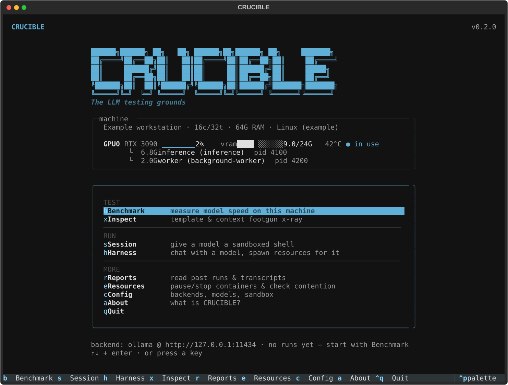

# CRUCIBLE

```
 ██████╗██████╗ ██╗   ██╗ ██████╗██╗██████╗ ██╗     ███████╗
██╔════╝██╔══██╗██║   ██║██╔════╝██║██╔══██╗██║     ██╔════╝
██║     ██████╔╝██║   ██║██║     ██║██████╔╝██║     █████╗
██║     ██╔══██╗██║   ██║██║     ██║██╔══██╗██║     ██╔══╝
╚██████╗██║  ██║╚██████╔╝╚██████╗██║██████╔╝███████╗███████╗
 ╚═════╝╚═╝  ╚═╝ ╚═════╝  ╚═════╝╚═╝╚═════╝ ╚══════╝╚══════╝
                                       POWERED BY ATHLAS.IO
```

**The LLM testing grounds.** A terminal app for finding out what your local
models — and your machine — can actually do: benchmark speed the way the
community measures it, audit determinism and tool-calling reliability, X-ray a
model for silent misconfiguration, or hand a model a sandboxed shell and a
real browser and watch it work.

Built for people who run LLMs locally and want *numbers they can trust*:
stddev or a confidence interval on everything, warmup excluded, exact vs
approximate always labeled, full provenance in every report, and no
cross-tool leaderboard claims.



## Why

Local-LLM tooling is full of silent failure: a missing `num_ctx` that makes
Ollama truncate long prompts without a word, chat templates that quietly break
tool calling, seeds that backends ignore, benchmark numbers with no error bars
and no record of what was measured. CRUCIBLE's job is to make those things
visible — and to make the visible things reproducible.

## What it does

### ⚖ Benchmark — five modes

| Mode | Question it answers | Method |
|---|---|---|
| **quick** | "How does this model feel?" | 4 real prompts × N runs, exact server metrics |
| **standard** | "What are my pp/tg numbers?" | `pp512`/`tg128`, llama-bench conventions: synthetic deterministic prompts, per-test warmup, 5 reps, mean ± stdev — the report includes a **llama-bench-style markdown table** you can post next to any llama.cpp result |
| **context sweep** | "Is it still fast at 16k?" | `pp/tg @ d4096/8192/16384` with the context primed into the KV cache; prompt-cache hits verified, misses honestly labeled full-prefill |
| **determinism** | "Does my backend honor the seed?" | Same prompt × 5, pinned seed, temperature 0 → verdict + first divergence position |
| **tool calling** | "Can this model actually call tools?" | 12 bundled BFCL-style cases × 3 trials: tool selection, typed argument filling, parallel calls, abstention — pass rates with 95% Wilson intervals. Nothing is ever executed |

Every mode also reports **latency distributions** — TTFT / TPOT / ITL / E2EL
with p50/p95/p99 per the NVIDIA NIM formulary, ITL pooled across runs (mean
tokens/s hides stutter; ITL p99 doesn't). On Ollama the numbers come from
exact server-side durations; on OpenAI-compatible backends they are wall-clock
and marked ≈.

Before you fire, **MODEL FACTS** shows what's relevant for the highlighted
model: trained context length, configured `num_ctx` (or the Ollama-default
warning), KV-cache cost per 1k tokens, and the practical context ceiling on
your currently-free VRAM.

Every run ends with a **Markdown report** — rendered in the terminal, saved to
disk with the raw JSON beside it — carrying model provenance (quant · size ·
family · context length · template sha256), server version, and the metric
definitions used.

### ⚗ Session — an LLM with its own shell

Spawns a disposable Docker container and drives an agent loop: the model gets
a `run_shell` tool (or a fenced-block protocol when the backend rejects
tools), proposes one command at a time, and every command lands in an
**approval modal** — command in full, `y / n / a` — before it runs. Resource
limits, network off by default, live terminal pane, Markdown transcript
written as it happens.

### ⌘ Harness — chat that can grow hands

A plain conversation with a model, until it needs more: attach a **terminal**
(persistent shell container), a **browser** (real headless Chromium over CDP —
cookies and logins survive between calls), or **search** (web search through a
SearXNG instance — search engines captcha headless browsers on sight; a
metasearch instance doesn't). Tools are namespaced per resource
(`terminal_run`, `browser_goto`, `search_web`, …); attach a second terminal
and it's `terminal2`. Reads run free, acts stop for approval. Works as an
ordinary chat with nothing attached.

### 🔍 Inspect — the model X-ray

The silent-footgun scanner: missing `num_ctx` (silent truncation), template
without a tool or system section, embedded double-BOS, stop sequences,
template sha256 and token overhead, plus a live probe of whether the backend
accepts native tool calling for this model. Saves a report.

### ⌾ Reports, ⚙ Config

Every benchmark, session and harness is saved automatically; browse, read,
open in `$EDITOR`, or delete them from the Reports screen. Config is one TOML
file where every setting explains itself in the UI — what it does and which
mode uses it.

## Install & run

Requirements: [uv](https://docs.astral.sh/uv/) (or Python ≥ 3.12), Docker for
sessions/harness resources, and a running [Ollama](https://ollama.com) and/or
any OpenAI-compatible server ([vLLM](https://docs.vllm.ai), llama.cpp server,
…).

```sh
git clone https://github.com/AthlasSoftware/crucible
cd crucible
uv run crucible
```

First run creates `~/.config/crucible/config.toml` with sane defaults (Ollama
on `127.0.0.1:11434`, vLLM on `127.0.0.1:8000`). Reports land in
`~/.local/share/crucible/{benchmarks,sessions}/`.

`crucible` opens the full-screen TUI. `crucible --inline` runs a scriptable
inline CLI instead — any non-TTY invocation (pipes, CI) falls back to it
automatically, with numbered prompts where empty input accepts the default.

## Configuration

```toml
[backend]
active = "ollama"            # ollama | vllm | openai

[backend.ollama]
base_url = "http://127.0.0.1:11434"
default_model = "llama3.1:8b"

[backend.vllm]
base_url = "http://127.0.0.1:8000"

[backend.openai]             # any OpenAI-compatible endpoint
base_url = ""
api_key = ""

[benchmark]
runs = 3                     # quick mode: generations per prompt
max_tokens = 256
warmup = true                # untimed load run so cold start doesn't skew run 1

[sandbox]                    # ⚗ sessions
image = "ubuntu:24.04"
cpus = 4.0
memory = "4g"
network = false              # flip on if the model should apt/pip install
approval = "approve-each"    # approve-each | auto
command_timeout_s = 60
max_iterations = 20

[harness]                    # ⌘ resources you hand a model mid-chat
terminal_image = "ubuntu:24.04"
browser_image = "mcr.microsoft.com/playwright/python:v1.55.0-noble"
cpus = 4.0
memory = "4g"
terminal_network = false     # browsers always get network; terminals opt in
approval = "approve-each"    # stops on acts, not on page reads
command_timeout_s = 60
max_tool_calls = 12
searxng_url = ""             # empty = autodetect a *searxng* docker container

[vllm_server]                # a vLLM CRUCIBLE can start itself (opt-in)
enabled = false
image = "vllm/vllm-openai:latest"
port = 8100
tensor_parallel_size = 1
gpu_memory_utilization = 0.90
max_model_len = 8192

[ui]
render_markdown = true       # false shows model replies byte-for-byte
```

## Methodology, honestly

- **Exact where possible, labeled where not.** Ollama's native API reports
  server-side `prompt_eval_duration` / `eval_duration` — tokenization and
  network excluded, matching llama-bench. OpenAI-compatible backends give
  wall-clock timings; those numbers are marked ≈ everywhere they appear.
- **Warmup excluded** — model load time is reported separately, never mixed
  into throughput.
- **Error bars on everything** — stdev over reps for throughput, Wilson 95%
  intervals for pass rates, percentiles for latency (pooled ITL, not
  average-of-averages).
- **Provenance in every report** — quant, parameter size, family, context
  length, template hash, server version, full parameters — so a number can be
  reproduced, or challenged.
- **No cross-tool comparisons** — API-side numbers include server overhead;
  CRUCIBLE says so instead of pretending otherwise.

## Notes & caveats

- Sessions and harness resources need the Docker socket (your user in the
  `docker` group). Containers are labeled (`crucible.session`,
  `crucible.harness`), released on exit, and a killswitch entry appears on the
  home screen whenever CRUCIBLE is holding anything.
- With `network = false` the sandbox model cannot install packages —
  intentional; flip it in Config when the task needs it.
- Benchmarking a model bigger than your free VRAM silently spills to CPU and
  produces honest-but-slow numbers — MODEL FACTS and the live GPU monitor
  show the contention before you start.
- The harness `search` resource needs a SearXNG instance with its JSON API
  enabled (`settings.yml` → `search.formats: [html, json]`).
- CRUCIBLE binds no ports of its own — it is purely a client of your servers.

## Roadmap

Concurrency sweeps (aggregate vs per-stream t/s), VRAM high-water mark and
tokens-per-joule, IFEval-style instruction-following with confidence
intervals, needle-in-a-haystack context-quality heatmaps, sandboxed code eval
(pass@1) using the existing Docker isolation, quant-ladder comparison,
sustained-load thermal soak.

## Contributing

Issues and PRs welcome — see [CONTRIBUTING.md](CONTRIBUTING.md). The short
version: `uv sync`, `uv run pytest`, `uv run ruff check`, and every measured
number needs its uncertainty stated.

## License

MIT © [ATHLAS.IO](https://athlas.io)
